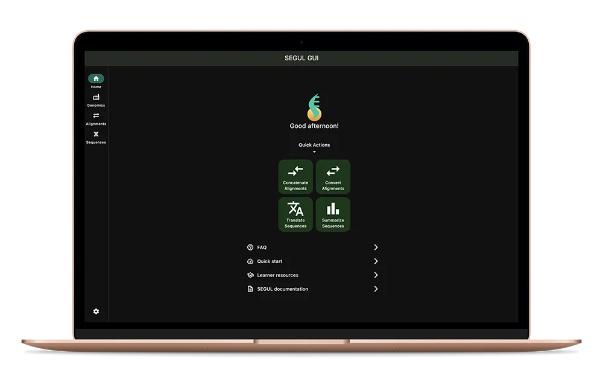

## Big changes in the version 0.19.0 💪🏼

- New command structure. Check [quick start](/docs/intro/)
  instruction to see the most up to date commands. We are working on updating the documentation throughout the website.
- New command to calculate summary statistics for raw reads and contigs.
- Input dir `-d` or `--dir` now can infer input format based on the file extension. No need to specify the input format anymore.
