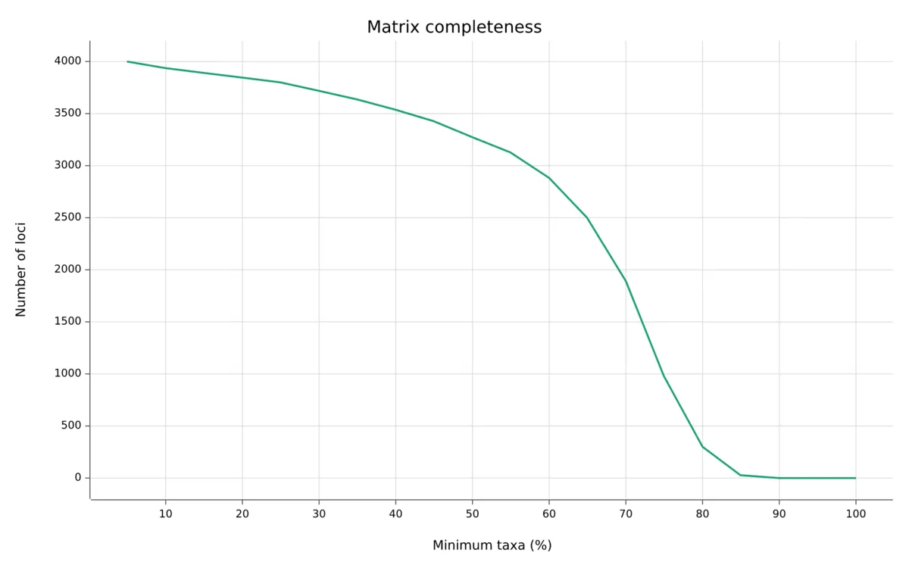
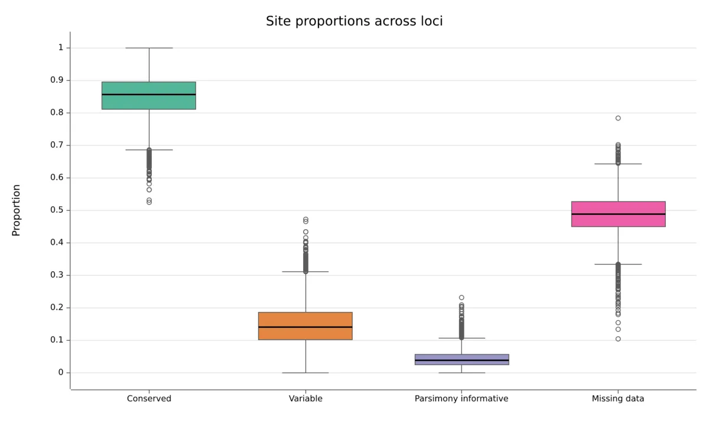
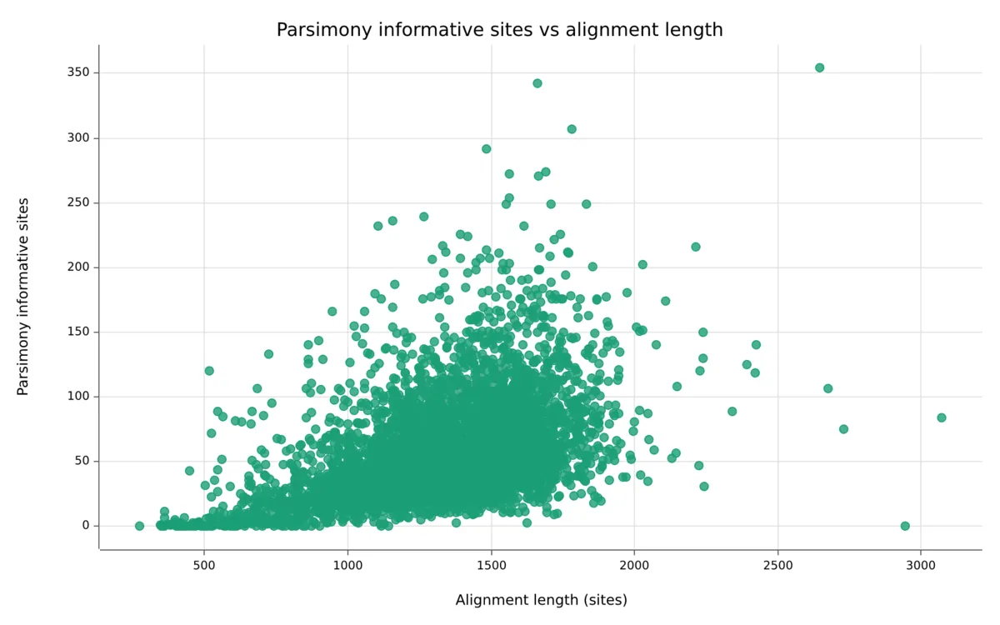
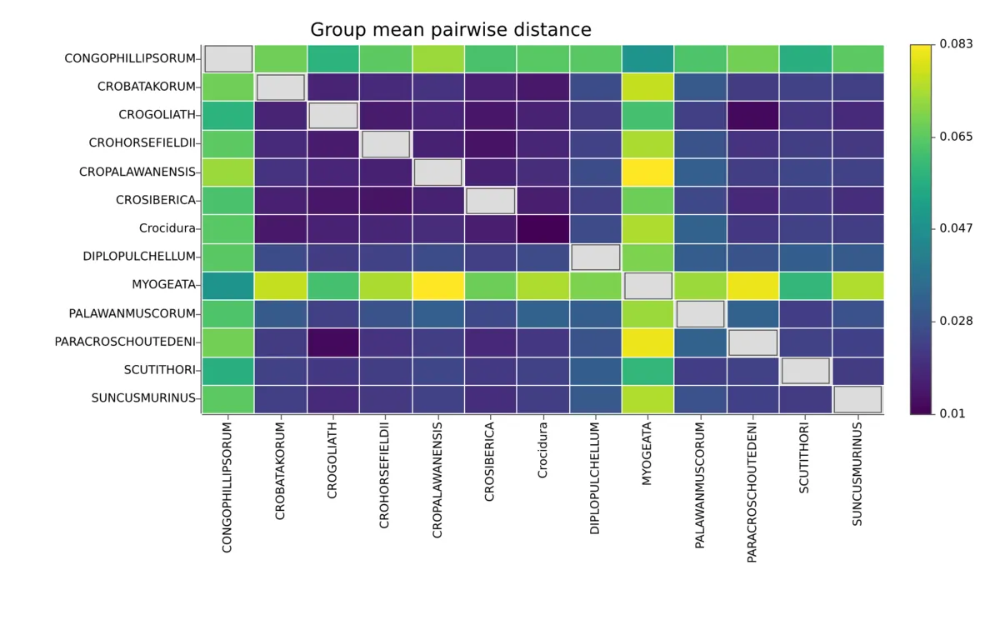
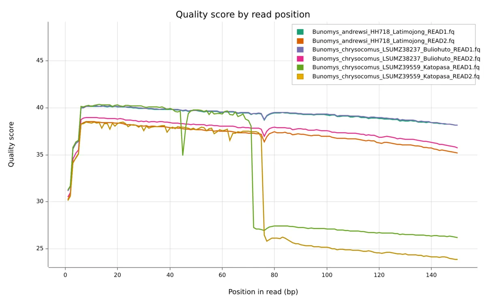
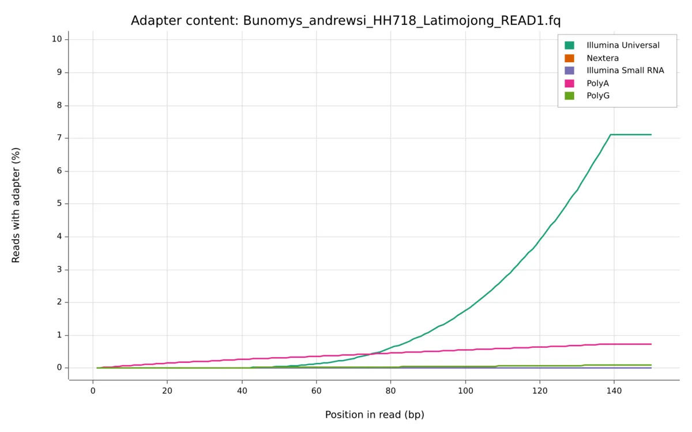

:::caution[Beta]
This feature is in beta and may still change.
:::

The summary classes can write charts, like the `--plot` option of the CLI, and return the paths of the files they write. PySEGUL can also load the JSON reports of these summaries as Python dictionaries.

## Charts

Pass `PlotOptions` as `plot` to any of these classes:

- [`AlignmentSummary`](/docs/api-usage/python/align_summary/) (not with `per_locus=True`)
- [`AlignmentDistance`](/docs/api-usage/python/align_distance/)
- [`ReadSummary`](/docs/api-usage/python/read_summary/)
- [`ContigSummary`](/docs/api-usage/python/contig_summary/)
- [`MafSummary`](/docs/api-usage/python/maf/)

Charts are written to the `plots` folder inside the output directory.

```python
import pysegul

def summarize_with_charts():
    plot = pysegul.PlotOptions(
        format='svg',
        palette='okabe-ito',
        colormap='cividis',
        )
    summary = pysegul.AlignmentSummary('nexus', 'dna', 'tests/output', plot=plot)
    outputs = summary.from_dir('tests/align-data')
    print(outputs['plots'])
```

All chart options:

| Option | Default | Description |
| --- | --- | --- |
| `format` | `'png'` | `'png'`, `'svg'`, or `'pdf'` |
| `font` | `None` | Font file for PNG and PDF text. Defaults to the system fonts |
| `palette` | `'dark2'` | `'dark2'`, `'okabe-ito'`, `'tol-bright'`, `'tol-muted'`, `'set2'`, `'paired'`, `'set1'` |
| `colormap` | `'viridis'` | `'viridis'`, `'cividis'`, `'magma'`, `'inferno'`, `'plasma'`, `'blues'`, `'greens'`, `'ylgnbu'`, `'ylorrd'`, `'rdbu'`, `'puor'`, `'brbg'` |
| `cvd` | `None` | Simulate a color vision deficiency: `'protanopia'`, `'deuteranopia'`, `'tritanopia'`, `'achromatopsia'` |

PNG and PDF charts need fonts. If none are found, PySEGUL raises a `ValueError`. Set `font` or use `format='svg'`.

### Sample charts

These charts use the default options. The alignment charts come from 4,040 UCE loci of shrews (Esselstyn et al. 2021). The read charts come from raw Illumina reads of *Bunomys* rats.







`AlignmentDistance` with `group_by_delimiter('_', 1)` also writes the mean distance between groups:



`ReadSummary` in `complete` mode writes charts for all samples and for each read file:





## Output paths

The `from_dir` and `from_files` methods of the summary classes return a dictionary of output paths. Outputs that were not written are `None`. Every dictionary also has `plots`, a list of chart paths, which is empty without `plot`.

| Class | Keys |
| --- | --- |
| `AlignmentSummary` | `locus`, `taxon`, `text`, `report` (empty dictionary with `per_locus=True`) |
| `AlignmentDistance` | `summary`, `per_locus_dir`, `group_mean`, `pairwise_long`, `report` |
| `ReadSummary` | `summary`, `positions`, `distributions`, `report` (`complete` mode only) |
| `ContigSummary` | `summary`, `report` |
| `MafSummary` | `per_file`, `per_species` |

`MafConversion` returns block and locus counts instead, such as `blocks_read` and `loci_written`.

## Reports

Load a JSON report as a dictionary:

| Function | Report |
| --- | --- |
| `load_align_report(path)` | Alignment summary |
| `load_contig_report(path)` | Contig summary |
| `load_distance_report(path)` | Genetic distances |
| `load_read_report(path)` | Read summary in `complete` mode |

```python
import pysegul

def load_report():
    summary = pysegul.ContigSummary('auto', 'tests/output')
    outputs = summary.from_dir('tests/contig-data')
    report = pysegul.load_contig_report(outputs['report'])
    print(report.keys())
```

The read report also has the read quality checks for each sample. See [Genomic Read Summary](/docs/api-usage/python/read_summary/#quality-checks).
